# RAG in Databricks — PDF → Chunks → Embeddings → Vector Search → Llama 3.3 70B

Complete reconstruction of the workshop **RAG dans Databricks** (22 pages):
three PDFs are dropped into a Unity Catalog Volume, split into overlapping
chunks, stored in a Delta table, indexed by **Databricks AI Search** (Vector
Search, Delta Sync, embeddings computed server-side) and queried by
**Llama 3.3 70B**, which answers only from the retrieved passages and cites
`[fichier, page]`.

Everything needed to rebuild it is here:

* the **notebook** (`notebooks/rag_databricks.py`), in Databricks source format,
  importable as-is — it reproduces the eight cells of the document;
* the **three sample PDFs** (`data/pdfs/`) that produce the documented
  **8 chunks**;
* **29 screenshots** extracted from the PDF (`images/`), used step by step below;
* a short **architecture diagram** (`docs/architecture.png`).

---

## 1. What the pipeline does

```
PDFs (Volume) → extract → clean → chunk (1000/150) → Delta rag_chunks (CDF)
                                                        │
                                          AI Search Delta Sync index
                                          (qwen3 embeddings, server-side)
                                                        │
question ──────────────────────────────▶ retrieve top-4 passages
                                                        │
                              SYSTEM_PROMPT + [fichier, page] context
                                                        │
                                    Llama 3.3 70B → answer + sources
```

★ No embedding is computed in the notebook: the index declares
`embedding_source_columns`, and the AI Search endpoint embeds both the chunks
and the query. ★

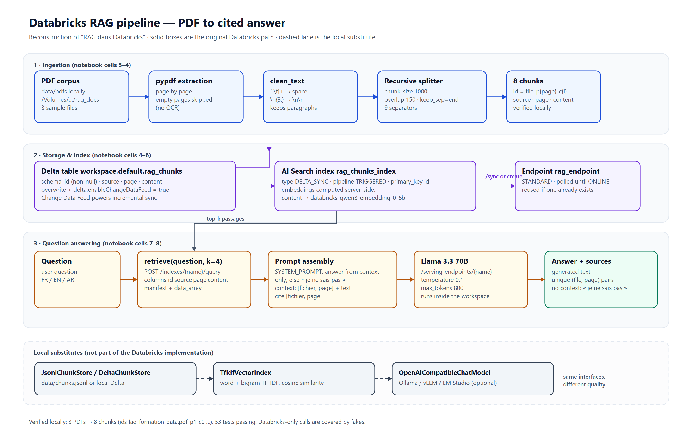

---

## 2. Repository layout

```
databricks-complete-rag-pipeline/
├── README.md
├── notebooks/
│   └── rag_databricks.py       # 8 cells: config → ingest → index → RAG
├── data/pdfs/                  # 3 fictional PDFs (7 pages, 8 chunks)
├── images/                     # 29 screenshots from the PDF
├── docs/architecture.png|svg|mmd
├── requirements-databricks.txt # %pip install list
├── requirements.txt            # same, for a local Python check
├── .env.example                # connection + parameter names
└── .gitignore
```

---

## 3. Prerequisites

| What | Detail |
|------|--------|
| Workspace | Databricks with Unity Catalog (Free Edition works) |
| Compute | Serverless or **DBR 15.4 LTS+** (Delta + AI Search) |
| Serving endpoints | one embedding model, one chat model |
| PDFs | `data/pdfs/*.pdf` (fictional documents, safe to upload) |

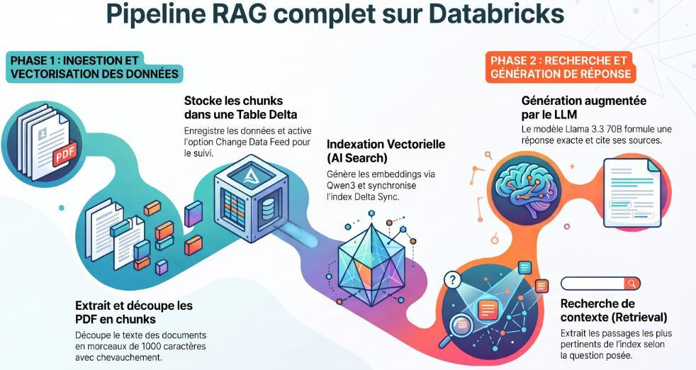

---

## Step 1 — Create the Volume and upload the PDFs

In **Catalog**, create a Volume `workspace.default.rag_docs` and upload the three
PDFs into it. Their content is fictional: a training FAQ, a water-purifier user
guide and an internal rules document — enough to ask real questions.

```sql
CREATE VOLUME IF NOT EXISTS workspace.default.rag_docs;
```

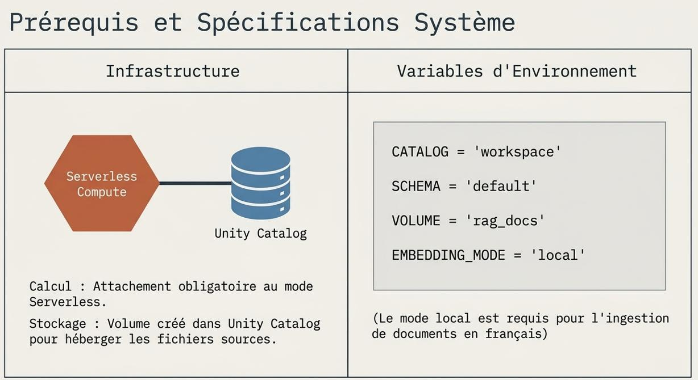
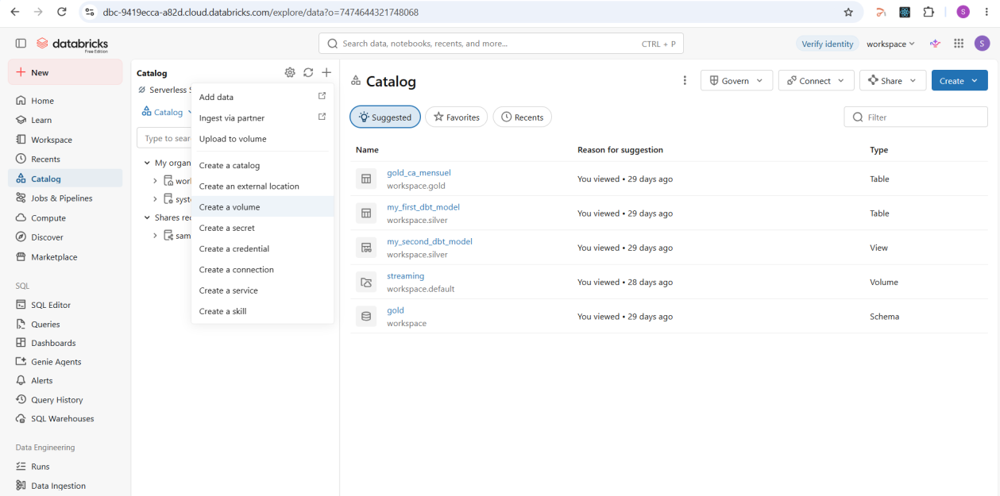

---

## Step 2 — Check the model endpoints

Open **Serving** and note the exact names:

| Role | Endpoint | Why this one |
|------|----------|--------------|
| Embeddings | `databricks-qwen3-embedding-0-6b` | multilingual — the documents are in French; falls back to `databricks-gte-large-en` |
| Generation | `databricks-meta-llama-3-3-70b-instruct` | instruction-following chat model, good citation behaviour |

The notebook lists the endpoints (`w.serving_endpoints.list()`) and switches to
the fallback embedding model automatically if the first one is unavailable.

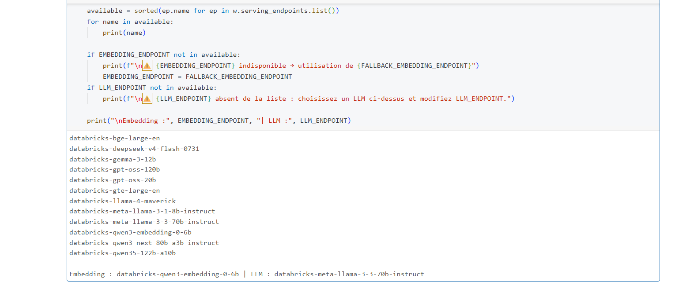

---

## Step 3 — Open the notebook and set the parameters

Create a notebook, attach compute, then paste the first cells of
`notebooks/rag_databricks.py`:

```python
CATALOG, SCHEMA, VOLUME = "workspace", "default", "rag_docs"
DOCS_PATH   = f"/Volumes/{CATALOG}/{SCHEMA}/{VOLUME}"

CHUNKS_TABLE = f"{CATALOG}.{SCHEMA}.rag_chunks"
INDEX_NAME   = f"{CATALOG}.{SCHEMA}.rag_chunks_index"
VS_ENDPOINT_NAME = "rag_endpoint"

CHUNK_SIZE, CHUNK_OVERLAP = 1000, 150
EMBEDDING_ENDPOINT = "databricks-qwen3-embedding-0-6b"
LLM_ENDPOINT       = "databricks-meta-llama-3-3-70b-instruct"
RECREATE_INDEX     = False
```

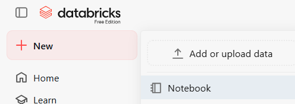


---

## Step 4 — Ingest the PDFs into chunks

The cell loops over the PDFs, extracts text page by page with `pypdf`, cleans
whitespace **without removing line breaks** (the splitter uses them), then splits
recursively:

```python
RecursiveCharacterTextSplitter(
    chunk_size=1000, chunk_overlap=150,
    separators=["\n\n", "\n", ". ", "? ", "! ", "; ", ", ", " ", ""],
    keep_separator="end", length_function=len,
)
chunk_id = f"{fname}_p{page_num}_c{i}"
```

Expected output for the three sample PDFs: **3 PDFs, 8 chunks**.

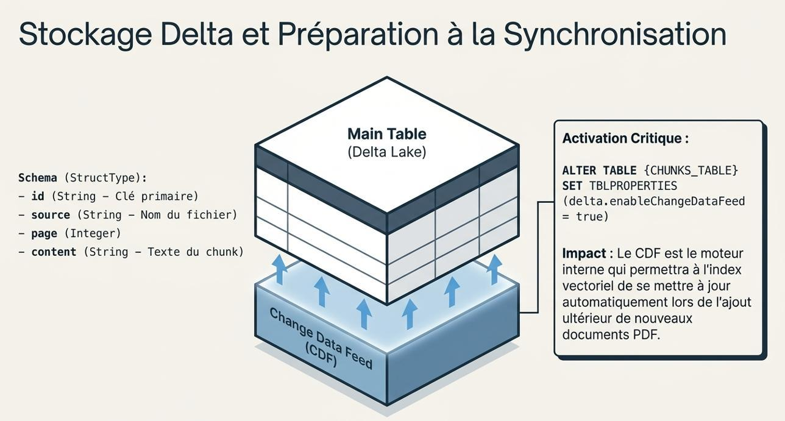
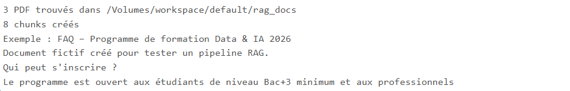

---

## Step 5 — Write the Delta table `rag_chunks`

Explicit schema, overwrite mode, then the Change Data Feed property that lets the
index follow updates:

```python
schema = StructType([
    StructField("id", StringType(), False),
    StructField("source", StringType(), True),
    StructField("page", IntegerType(), True),
    StructField("content", StringType(), True),
])
(spark.createDataFrame(rows, schema).write.mode("overwrite")
      .option("overwriteSchema", "true").saveAsTable(CHUNKS_TABLE))

spark.sql(f"ALTER TABLE {CHUNKS_TABLE} "
          "SET TBLPROPERTIES (delta.enableChangeDataFeed = true)")
```

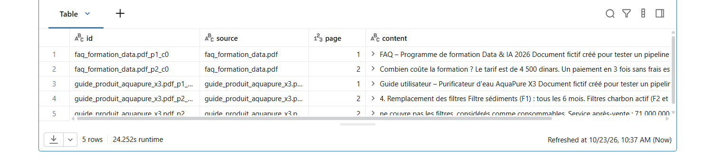

---

## Step 6 — Create the AI Search endpoint

The notebook reuses an existing Vector Search endpoint if there is one,
otherwise creates `rag_endpoint` (`STANDARD`), then polls until `ONLINE`.

```python
endpoints = api.do("GET", "/api/2.0/vector-search/endpoints").get("endpoints", [])
```

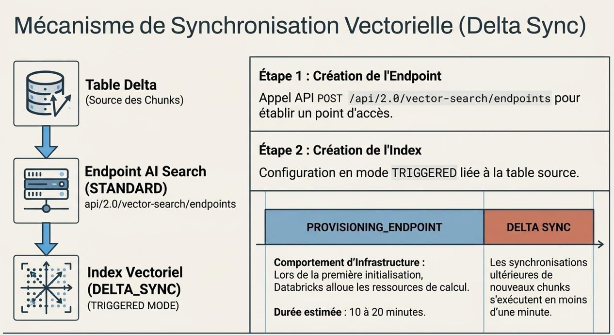
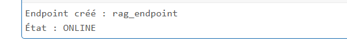

---

## Step 7 — Create the Delta Sync index

```python
api.do("POST", "/api/2.0/vector-search/indexes", body={
    "name": INDEX_NAME,
    "endpoint_name": VS_ENDPOINT_NAME,
    "primary_key": "id",
    "index_type": "DELTA_SYNC",
    "delta_sync_index_spec": {
        "source_table": CHUNKS_TABLE,
        "pipeline_type": "TRIGGERED",
        "embedding_source_columns": [
            {"name": "content",
             "embedding_model_endpoint_name": EMBEDDING_ENDPOINT},
        ],
    },
})
```

If the index already exists it is synchronised (`/sync`); if `RECREATE_INDEX` is
`True` it is deleted and rebuilt — required when you change the embedding model,
because vectors from two models are not comparable.

Wait until `status.ready` is true and `indexed_row_count = 8`.

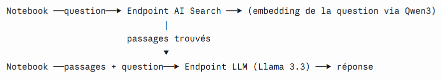
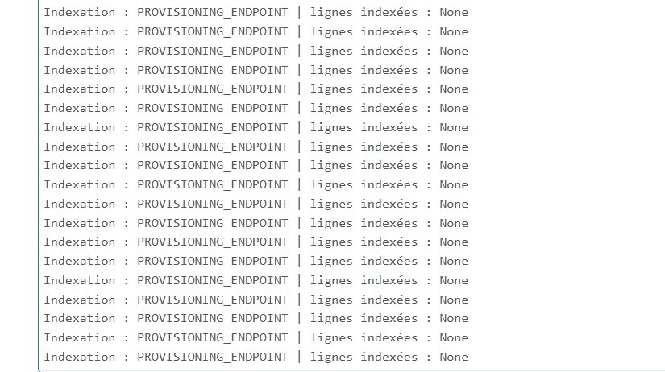
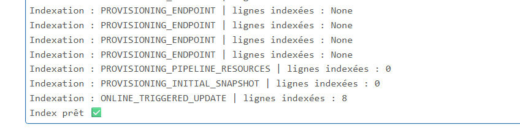

---

## Step 8 — Test retrieval

The query asks for four columns and returns `manifest.columns` +
`result.data_array`; the helper zips them into dictionaries.

```python
res = api.do("POST", f"/api/2.0/vector-search/indexes/{INDEX_NAME}/query", body={
    "columns": ["id", "source", "page", "content"],
    "query_text": question,
    "num_results": k,
})
```

`score` is **not** requested — this is why the original notebook prints
`[0.000]`: `hit.get("score", 0)`. Keep that behaviour or add `"score"` to the
columns if you want real similarity values.

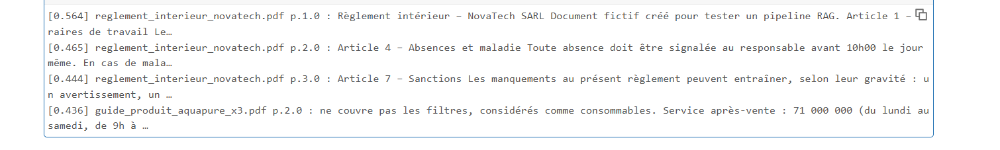

---

## Step 9 — Generate the answer with Llama 3.3 70B

The context is assembled as `[fichier, page]` + text, and the system prompt
forbids answering outside the context:

```python
SYSTEM_PROMPT = (
    "Tu es un assistant qui répond uniquement à partir du contexte fourni. "
    "Si la réponse n'est pas dans le contexte, dis que tu ne sais pas. "
    "Cite tes sources sous la forme [fichier, page]. Réponds dans la langue de la question."
)

resp = api.do("POST", f"/serving-endpoints/{LLM_ENDPOINT}/invocations", body={
    "messages": [
        {"role": "system", "content": SYSTEM_PROMPT},
        {"role": "user", "content": f"Contexte :\n{context}\n\nQuestion : {question}"},
    ],
    "temperature": 0.1,
    "max_tokens": 800,
})
answer = resp["choices"][0]["message"]["content"]
```

Try:

* *« Que faire si le voyant orange clignote sur l'AquaPure X3 ? »* → answer from
  `guide_produit_aquapure_x3.pdf`, page 1–2.
* *« Quels sont les horaires de travail chez NovaTech ? »* → answer from
  `reglement_interieur_novatech.pdf`, page 1.
* *« Quel est le chiffre d'affaires 2023 ? »* → the model must answer that the
  corpus does not contain it.

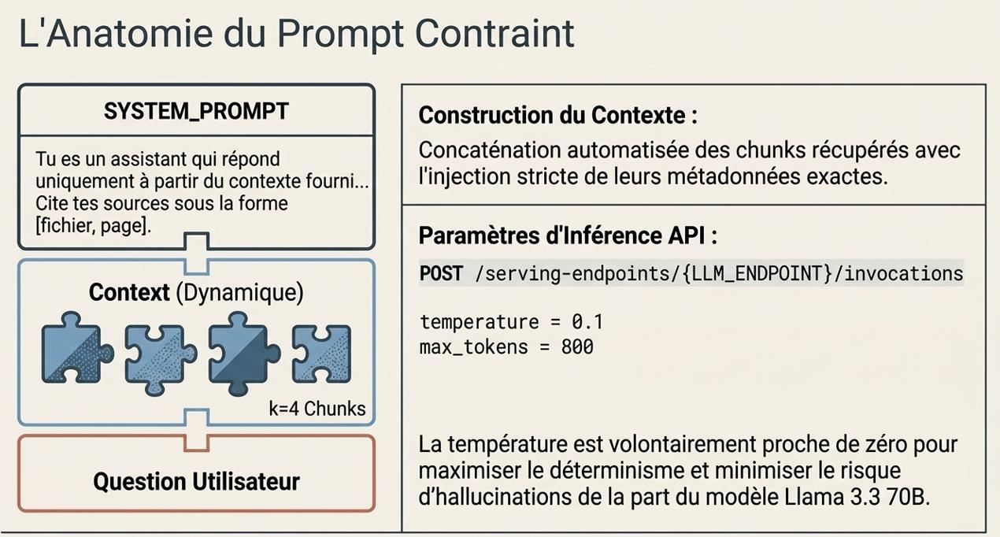
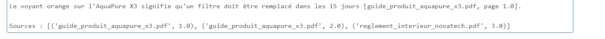

---

## Notebook reference

| Cell | Content | Key parameters |
|------|---------|----------------|
| 1 | Configuration | catalog, volume, table/index names, chunk size, endpoints |
| 2 | Endpoint check + embedding fallback | `serving_endpoints.list()` |
| 3 | PDF → chunks | `pypdf`, `clean_text`, splitter, `id = f"{fname}_p{page}_c{i}"` |
| 4 | Delta table + CDF | explicit `StructType`, `overwriteSchema` |
| 5 | Vector Search endpoint | reuse or create, poll `ONLINE` |
| 6 | Delta Sync index | `DELTA_SYNC`, `TRIGGERED`, `embedding_source_columns` |
| 7 | Retrieval | `/query`, `id/source/page/content`, `num_results=k` |
| 8 | RAG | `SYSTEM_PROMPT`, `temperature=0.1`, `max_tokens=800` |

Import it with *Workspace → Import → File* (format **Source**).

---

## Expected results

| Check | Expected |
|-------|----------|
| PDFs found | 3 |
| Chunks created | **8** |
| `rag_chunks` rows | 8 |
| Change Data Feed | `delta.enableChangeDataFeed = true` |
| Endpoint state | `ONLINE` |
| `indexed_row_count` | 8 |
| Retrieval | 4 passages with `source` and `page` |
| Answer | text in the question's language, with `[fichier, page]` citations |

Chunk ids produced by the sample corpus:

```
faq_formation_data.pdf_p1_c0 · faq_formation_data.pdf_p2_c0
guide_produit_aquapure_x3.pdf_p1_c0 · …_p2_c0 · …_p2_c1
reglement_interieur_novatech.pdf_p1_c0 · …_p2_c0 · …_p3_c0
```

Chunk sizes: 999, 746, 956, 950, 202, 995, 926, 291 characters — all ≤ 1000.

---

## Tuning and cost

| Parameter | Effect |
|-----------|--------|
| `CHUNK_SIZE` / `CHUNK_OVERLAP` | smaller chunks = more precise retrieval, more rows |
| `EMBEDDING_ENDPOINT` | changing it requires `RECREATE_INDEX = True` |
| `pipeline_type` | `TRIGGERED` (manual `/sync`) or `CONTINUOUS` (live updates) |
| `k` | number of passages sent to the LLM (4 by default) |
| `temperature` | 0.1 keeps answers factual; raise it for more varied phrasing |

Endpoints bill per DBU while they run. After the demo:

```python
api.do("DELETE", f"/api/2.0/vector-search/indexes/{INDEX_NAME}")
api.do("DELETE", f"/api/2.0/vector-search/endpoints/{VS_ENDPOINT_NAME}")
```

---

## Troubleshooting

| Symptom | Cause | Fix |
|---------|-------|-----|
| `0 PDF trouvés` | wrong `DOCS_PATH` | check the Volume name: `/Volumes/workspace/default/rag_docs` |
| `ValueError: ... introuvable` | LLM endpoint name differs | copy the exact name from the endpoint list (cell 2) |
| index stays `PROVISIONING` | endpoint still starting | wait; it can take several minutes the first time |
| `indexed_row_count = 0` | table written after the index was created | call `/sync` or set `RECREATE_INDEX = True` |
| retrieval returns irrelevant passages | text-layer missing in the PDF, or chunk too large | check extraction output; reduce `CHUNK_SIZE` |
| model answers from general knowledge | the passage was not retrieved | verify with the retrieval cell before blaming the model |
| `PIL`/`pypdf` import error | missing library | cell 1 runs `%pip install -q pypdf langchain-text-splitters` |

---

## Security notes

* No credential is written in the notebook: `WorkspaceClient()` uses the
  workspace context. Do not paste tokens into cells (they stay in history).
* Documents, prompts and answers stay inside the workspace: both the embedding
  model and Llama are served by Databricks.
* Any text inside a PDF can try to override the system prompt (prompt
  injection). Index trusted documents only, and check citations for sensitive
  use cases.
* The assistant answers with the permissions of the user running the notebook:
  grant `SELECT` on `rag_chunks` and `USE` on the index only to the intended
  audience.

## License

MIT. Screenshots belong to the original workshop document and are included for
pedagogical use; the PDFs in `data/pdfs/` are fictional.
